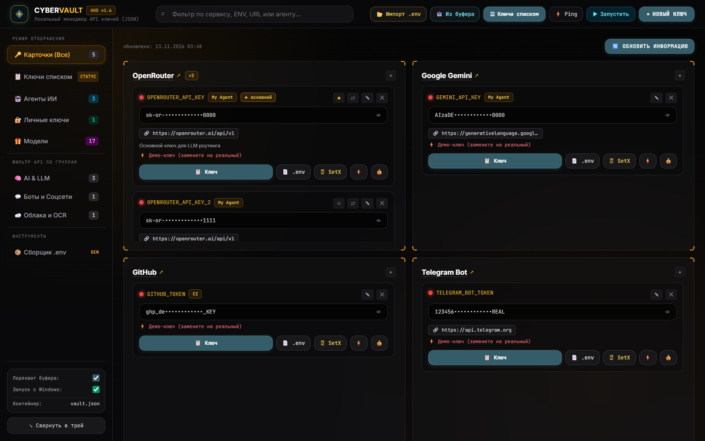
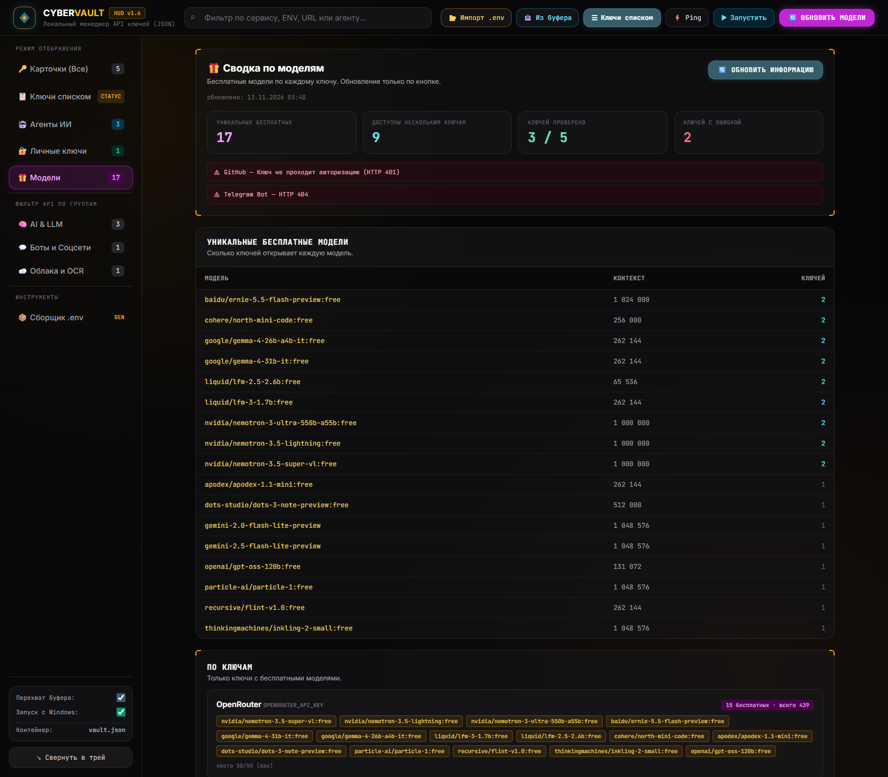

<div align="center">

# ◈ CYBER-VAULT

**Локальный диспетчер API-ключей, портативных ИИ-агентов и личных секретов.**
Dark Luxury / Cyber-HUD · Windows · портативный · без облака и без базы данных

[](LICENSE)
[](https://www.python.org/)
[](https://www.microsoft.com/windows)
[](https://github.com/softt1970-blip/CYBER-VAULT/actions/workflows/ci.yml)


</div>



<div align="center"><sub>Карточки провайдеров, маскирование ключей, живая проверка в один клик, сводка бесплатных моделей</sub></div>

---

## ⚡ Быстрый старт

```powershell
1. Скопируйте папку CYBER-VAULT куда угодно (например на флешку)
2. Запустите start.bat
3. Откроется дашборд в браузере + иконка ◈ в системном трее
```

Нужен **Python 3.10+** и **Microsoft Edge**. Зависимости (`pystray`, `pillow`, `pyperclip`)
ставятся **внутрь папки** в `libs\` — глобальный Python не затрагивается.

Первый запуск создаёт `vault.json` — хранилище. Готовый пример структуры: [`vault.example.json`](vault.example.json).

---

## 🎯 Что умеет

### 🗂 Хранилище ключей

| | |
|---|---|
| 🗂 **Карточки по провайдерам** | Один провайдер — одна карточка, счётчик `×N` у названия |
| 👁 **Маска и разглаживание** | Значение скрыто, пока не нажмёте 👁 |
| 📋 **Копирование** | С чистым токеном и **автоочисткой буфера через 15 секунд** |
| 📄 **Строка `.env`** | Готовая строка `KEY="value"` — вставить без правок |
| 🖥 **SetX** | Переменная сразу попадает в Windows ENV — доступна в IDE и терминале |
| ⚡ **Ping** | Баланс OpenRouter, имя бота Telegram, статус Gemini, HTTP-код своего API |
| 🔍 **Поиск и фильтры** | По сервису, переменной, тегу проекта, заметке и URL |
| 📋 **Табличный вид** | Колонка статуса для десятков ключей |

### ⭐ Несколько ключей у одного провайдера

- **★** — основной ключ: именно его значение попадёт в переменную окружения.
- **⇄** — ротация: все ключи провайдера склеиваются в одну переменную через запятую,
  и провайдер сам перебирает их при лимитах:

```dotenv
OPENROUTER_API_KEY="sk-or-v1-...first,sk-or-v1-...second"
```

### 📦 Сборщик `.env`

Список **по провайдерам**, а не по ключам: одна строка — одна переменная. Галочками выбираете
нужное, копируете результат или сохраняете `.env` на диск.

### 📂 Импорт `.env` из проекта

Указываете папку → сканируются все `.env` (вложенные до 3 уровней) → выбираете нужное →
ключи попадают в базу. Провайдер определяется автоматически по имени переменной
(`OPENROUTER_API_KEY` → OpenRouter, `GEMINI_API_KEY` → Gemini, `ghp_…` → GitHub и т.д.),
дубли по имени переменной пропускаются.

### 📥 Перехват буфера обмена

Фоновый watcher ловит скопированные ключи — и чистые (`sk-or-v1-…`, `AIza…`, `gsk_…`, `ghp_…`),
и блоки вида `KEY="VALUE"` — и предлагает внести их в базу одним кликом.

### 🎁 Сводка по моделям

Вкладка **🎁 Модели** спрашивает у каждого ключа его каталог (`/v1/models`) и собирает
**бесплатные модели** в одной таблице: сколько уникальных, сколько ключей их открывают,
какой у модели контекст.



| | |
|---|---|
| 🆓 **Бесплатные модели** | Отмечаются по маркеру в id (`:free`, `free/`) и по нулевой цене — платные `*-latest` не попадают |
| 🔢 **Счётчик уникальных** | В сайдбаре — сколько разных бесплатных моделей открывают ваши ключи |
| 🔑 **Блок по ключам** | Только ключи с бесплатными моделями: сколько моделей и сколько всего в каталоге |
| ⚠️ **Предупреждения** | Битые ключи и провайдеры без каталога видно сразу, а не по ошибке в логе |
| 💳 **Квота и баланс** | Дневная квота бесплатных запросов OpenRouter, баланс Kimi, заголовки rate-limit |
| 🔄 **Только по кнопке** | Обновление запускается вручную и идёт в фоне — интерфейс не подвисает |

Ключ при этом уходит **только своему провайдеру** — тому, чей `base_url` указан в карточке.

### 🤖 Диспетчер ИИ-агентов

| | |
|---|---|
| 🎨 **Иконка из приложения** | Достаётся из самого `.exe` агента (Windows GDI). Нет иконки — стоковый эмодзи |
| 🚀 **Запуск в один клик** | Кнопка в карточке, клик по иконке или быстрый запуск из шапки |
| 🔎 **Умный поиск цели** | Указанная папка разбирается сама: ищется `.exe` / `.bat` / `.cmd` / `.lnk` |
| 🔗 **Ключи в окружении** | Привязанные ключи передаются в процесс при запуске — агенту не нужен свой `.env` |
| 🔍 **Контроль зависимостей** | Если у привязанного ключа красный статус — загорается лампочка |

### 🔐 Личные ключи

Отдельное пространство для паролей, лицензий и SSH-доступов. Копирование — с автоочисткой буфера.
**Примечание редактируется прямо в карточке** (textarea — сохранение в `vault.json` при потере
фокуса), кнопка `📝 в блокноте` и `⟳` (Забрать изменения из блокнота) остались.

### 🚀 Автозапуск с Windows

Чекбокс в сайдбаре — иконка ◈ появляется в трее при старте системы.

### 💾 Автоматические бекапы

`vault.json` пишется **атомарно** (временный файл → `os.replace`), поэтому физически не может
остаться битым. После каждого изменения в `backup\` появляется копия; хранится кольцо из 20 последних.

---

## 🧰 Портативность

Правило проекта: **ничего не пишется за пределами папки**.

| Что | Где лежит |
|-----|-----------|
| Зависимости | `libs\` (`pip --target`, глобальный Python не трогаем) |
| Хранилище | `vault.json` в корне |
| Бекапы | `backup\vault_*.json` |
| Кэш сводки по моделям | `models_cache.json` в корне |
| Заметки для Блокнота | `notes\` |
| Экспорт `.env` | только внутри папки проекта |

Импорт `.env` из чужих папок — только чтение; запись всегда в свой `vault.json`.

---

## ⚠️ Безопасность

**Ключи хранятся в открытом виде** — в `vault.json` рядом с программой. Это осознанный выбор:
приложение работает без мастер-пароля и без шифрования, чтобы база читалась мгновенно и переносилась
на флешке.

Что стоит учесть:

- `vault.json` и папка `backup\` **не должны попадать в git** — в `.gitignore` они уже есть.
- Копия ключа автоматически стирается из буфера обмена через 15 секунд.
- Кнопка «🔄 Обновить информацию» отправляет ключ **только его провайдеру** — по `base_url`
  из карточки. Сторонних сервисов нет. В `models_cache.json` значений ключей нет: только
  id моделей, контекст, цены и id ключей. Сам файл тоже закрыт в `.gitignore`.
- Для переноса на другую машину положите папку на шифрованный диск или в архив с паролем.
- Ключи в примерах и на скриншотах — демонстрационные, они не рабочие.

---

## 🛠 Разработка

```powershell
# полная проверка: статика + все эндпоинты + параллельность сервера
python tools\check.py

# только статика (быстро, не трогает vault.json)
python tools\check.py --static
```

`tools/check.py` прогоняет компиляцию, `pyflakes`, `node --check` встроенного JS, проверку
того, что все вызываемые JS-функции определены, все HTTP-эндпоинты (включая битые данные)
и тест параллельности сервера. Тестовые записи создаёт и удаляет сам.

Подробности архитектуры, инварианты и известные грабли — в [`AGENTS.md`](AGENTS.md).

### Структура

```
CYBER-VAULT/
├── app.py                 всё приложение: Python-бэкенд + интерфейс
├── start.bat              лаунчер
├── vault.example.json     пример хранилища
├── models_cache.json      кэш сводки по моделям (не в git)
├── tools/check.py         проверка проекта
├── docs/                  скриншоты
├── libs/                  локальные зависимости (не в git)
├── backup/                бекапы (не в git)
└── notes/                 заметки (не в git)
```

---

## 📄 English summary

**CYBER-VAULT** is a single-file Windows desktop app (Python stdlib + inline HTML/CSS/JS) that
manages API keys, portable AI agents and personal secrets — entirely inside one portable folder.

- Grouped key cards per provider, masked values, one-click copy with 15-second clipboard wipe
- Multi-key providers: pick a primary key (★) or enable comma-separated rotation (⇄)
- `.env` builder per provider, `.env` importer with automatic provider detection
- Clipboard watcher that catches copied API keys
- Free-model summary per key: catalogue probe, unique free models with context length,
  provider quota and balance — refreshed manually, never automatically
- AI-agent dispatcher: icons extracted from the real `.exe`, smart target resolution, linked
  keys injected into the launched process environment
- Personal vault with notes that open in Notepad
- Atomic storage writes plus a rotating backup ring
- Zero writes outside the project folder; dependencies live in `libs/`

Requires Python 3.10+ and Microsoft Edge. Keys are stored **in plaintext** — see the security notes.

## 📜 License

[MIT](LICENSE)
