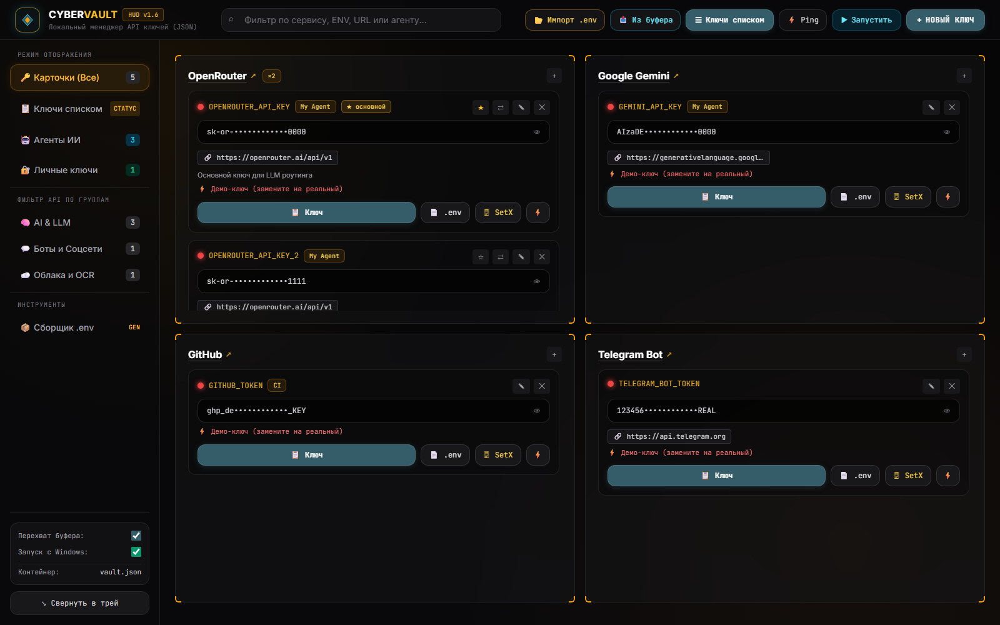

# ◈ CYBER-VAULT

> **Локальный диспетчер API-ключей, портативных ИИ-агентов и личных секретов.**
> Dark Luxury / Cyber-HUD интерфейс с янтарно-изумрудным свечением.
> Всё живёт в одной папке. Ничего не уходит наружу.



---

## ⚡ Быстрый старт — 3 шага

| # | Действие | Что произойдёт |
|---|----------|----------------|
| 1️⃣ | Запустить `start.bat` | Скрипт найдёт Python, поднимет зависимости **внутри папки** (`libs\`) и стартует приложение |
| 2️⃣ | Дождаться окна | Откроется дашборд в Edge (режим приложения) + иконка **◈** в системном трее |
| 3️⃣ | Нажать **+ Новый ключ** | Ключ попадёт в `vault.json` и сразу станет доступен для копирования, `.env`, SetX и запуска агентов |

> 🔁 **Повторный запуск** всегда безопасен: старый экземпляр закрывается, порт освобождается, новый поднимается на `http://127.0.0.1:17555`.

---

## 🗂 Хранилище ключей — карточки провайдеров

Ключи сгруппированы **по провайдеру**: один провайдер = одна карточка, внутри — все его ключи.
Счётчик `×N` у названия показывает, сколько ключей у провайдера.

### 🔎 Что есть в карточке ключа

| Элемент | Назначение |
|---------|-----------|
| 🟢 Точка слева | Статус после проверки ⚡ (зелёный — рабочий, красный — нет, жёлтый — идёт проверка) |
| `OPENROUTER_API_KEY` | Имя переменной окружения (моноширинный янтарный) |
| `VIZOR / VS Code` | Тег проекта — для кого этот ключ |
| `🔗 https://…/v1` | Базовый HTTP URL, клик копирует его |
| `sk-or-••••••••••••f40d` | Само значение в маске |
| 👁 | Показать / скрыть значение |
| 📝 Текст под ключом | Заметка, клик открывает редактирование |

### 🛠 Кнопки действий (в каждом ключе)

| Кнопка | Что делает |
|--------|------------|
| 📋 **Ключ** | Копирует чистый токен в буфер обмена и запускает **таймер автоочистки на 15 секунд** (внизу экрана горит обратный отсчёт, буфер стирается сам) |
| 📄 **.env** | Копирует готовую строку вида `OPENROUTER_API_KEY="sk-or-v1-..."` — вставить в `.env` без правок |
| 🖥 **SetX** | Пишет переменную прямо в Windows ENV (`setx`) — она сразу доступна в IDE, терминале и новых процессах |
| ⚡ | Проверка живости ключа (см. ниже) |
| ✎ | Редактировать ключ |
| ✕ | Удалить ключ |

### ⚡ Проверка ключа (Ping) — что именно проверяется

| Провайдер | Запрос | Что покажет |
|-----------|--------|-------------|
| **OpenRouter** | `GET /api/v1/auth/key` | `Рабочий │ Потрачено: $0.034 / Лимит: Безлимит` — реальный баланс |
| **Telegram** | `getMe` | `Рабочий │ Бот @my_bot` — имя бота |
| **Gemini** | `GET /models?key=…` | `Рабочий │ Gemini API (200 OK)` |
| **Свой API** | `GET {base_url}/models` | `Рабочий │ HTTP 200 (https://…)` или `Неверный ключ │ HTTP 401` |
| **Без base_url** | локально | `Формат корректен` — проверка длины токена |

Кнопка **⚡ Ping** в шапке проверяет **все** ключи разом. Красная лампочка рядом с ключом означает «не запускай агента вхолостую».

### 🔍 Фильтры

- **Поиск** в шапке — по сервису, имени переменной, тегу проекта, заметке и URL.
- **Фильтр по группам** в сайдбаре: `AI & LLM`, `Боты и Соцсети`, `Облака и OCR`.
- **Ключи списком** — табличный вид с колонкой статуса для быстрой проверки десятков ключей.

---

## ⭐ Провайдер: основной ключ и ротация

Когда у провайдера **несколько** ключей, в каждом блоке появляются две кнопки:

| Кнопка | Смысл |
|--------|-------|
| ★ / ☆ | **Основной ключ.** Значение именно его попадёт в переменную окружения |
| ⇄ | **Ротация.** Все ключи провайдера склеиваются в одну переменную через запятую |

**Как это работает:**

```
Без ротации    →  OPENROUTER_API_KEY="sk-or-v1-…f40d"
С ротацией     →  OPENROUTER_API_KEY="sk-or-v1-…f40d,sk-or-v1-…aa11,sk-or-v1-…bb22"
```

OpenRouter, OpenAI-совместимые шлюзы и большинство SDK умеют сами перебирать несколько ключей из одной переменной — так лимит не выбивается мгновенно.

> Имя переменной всегда берётся у **первого** ключа группы (каноническое) — переключение основного не ломает уже настроенные `.env` и скрипты.

---

## 📦 Сборщик `.env`

В сайдбаре → **Сборщик .env**.

- Список **по провайдерам**, а не по ключам: одна строка = одна переменная окружения.
- Галочки выбирают, что попадёт в файл; справа видно `×N` (сколько ключей) и `⇄` (ротация включена).
- Кнопка **📄 Скопировать** — весь файл в буфер.
- Кнопка **⬇ Сохранить в файл** — записать `.env` на диск.

```
# Generated by CYBER-VAULT
OPENROUTER_API_KEY="sk-or-v1-…"
OPENROUTER_BASE_URL="https://openrouter.ai/api/v1"
```

> 🔒 **Защита от выхода за папку.** Экспорт `.env` работает **только внутри папки проекта** — путь снаружи отклоняется с сообщением «Путь вне папки проекта запрещен».

---

## 📂 Импорт `.env` из проекта

Кнопка **📂 Импорт .env** в шапке.

1. Укажите папку проекта (например `C:\Apps\my-project`).
2. **🔍 Сканировать** — найдутся все `.env`, `*.env`, `.env.*` (вложенные до 3 уровней, без `node_modules`, `venv`, `models`).
3. Список найденных переменных с чекбоксами — ключеподобные (`KEY`, `TOKEN`, `SECRET`, `PASSWORD`) отмечены заранее.
4. **⬇ Импортировать выбранные** — ключи добавятся в базу.

| Умение | Детали |
|--------|--------|
| 🧠 Автоопределение провайдера | `OPENROUTER_API_KEY` → OpenRouter, `GEMINI_API_KEY` → Google Gemini, `HF_TOKEN` → HuggingFace, `ghp_…` → GitHub и т.д. |
| 🚫 Защита от дублей | Переменная с уже существующим именем не импортируется повторно |
| 📝 Метка источника | В заметке сохраняется «Импорт из <путь к файлу>» |

---

## 📥 Перехват буфера обмена

Фоновый watcher раз в секунду смотрит буфер обмена.

- Видит **чистые ключи** (`sk-or-v1-…`, `AIza…`, `gsk_…`, `ghp_…`, `hf_…`, токены Telegram) — и **блоки вида `KEY="VALUE"`**.
- Появляется баннер «Обнаружен новый API-ключ» → **✓ Внести в базу** или **Игнорировать**.
- Копирование ключа из приложения тоже сразу подхватывается.

> 🤫 Скопированные вами ключи автоматически попадают в «игнор» — программа не придумает свой собственный ключ.

---

## 🤖 Диспетчер ИИ-агентов

Вкладка **🤖 Агенты ИИ** — запуск локальных и портативных агентов в один клик.

### 🎨 Иконка из самого приложения

Иконка карточки **достаётся из `.exe` самого агента** (Windows GDI: `ExtractIconEx` → `GetIconInfo` → `GetDIBits` → PNG). Нет иконки — подставляется стоковый эмодзи.

### 🚀 Запуск

| Способ | Поведение |
|--------|-----------|
| Клик по иконке | Запуск агента |
| **▶ Запустить** | То же самое, крупная кнопка в карточке |
| **▶ Запустить** в шапке | Быстрый запуск: выпадающий список всех агентов с иконками |

**Умный поиск цели:** указанную папку программа разбирает сама — находит внутри `.exe`, `.bat`, `.cmd` или `.lnk` (в том числе на один уровень вглубь), отдаёт приоритет имени папки и файлам `start/run/launch`. Путь в кавычках распознаётся. Нет файла — команда ищется в `PATH`, и если её нет, вы получаете честное «Команда не найдена», а не тишину.

### 🔗 Ключи уходят в запущенный процесс

Привязанные к агенту ключи превращаются в **переменные окружения** запускаемого процесса — с учётом ★ и ⇄. Агенту не нужен свой `.env`: он стартует уже с ключами.

> 💬 В уведомлении видно, сколько переменных передано: «Запущено: … · переменных передано: 2».

### 🔍 Контроль зависимостей

У каждого агента видно привязанные ключи. Кнопка ✎ открывает список — можно отметить нужные. Если у привязанного ключа красный статус (нерабочий или лимит исчерпан) — рядом с агентом загорается **красная лампочка**.

---

## 🔐 Личные ключи (Personal Vault)

Отдельное пространство с изумрудным свечением: пароли, лицензии, SSH-ключи, доступы к серверам.

| Функция | Детали |
|---------|--------|
| 📋 **Скопировать** | Копирует значение и запускает **15-секундный таймер автоочистки буфера** |
| 📝 **Примечание** | Клик по полю заметки **открывает текст в Блокноте** — правите в привычном редакторе |
| ⟳ **Забрать изменения** | Кнопка рядом с заметкой читает файл из Блокнота обратно в `vault.json` |
| 🔒 **Маска** | Значение скрыто звёздочками, пока не нажмёте 👁 |

Файлы заметок лежат в `notes\` рядом с программой — внутри папки проекта.

> 📝 Файлы блокнота пишутся в UTF-8 с BOM и читаются обратно без BOM — кириллица не превращается в кракозябры.

---

## 🚀 Автозапуск с Windows

Чекбокс **«Запуск с Windows»** в сайдбаре. Программа регистрирует себя в `HKCU\Software\Microsoft\Windows\CurrentVersion\Run` и стартует вместе с системой — иконка ◈ появляется в трее.

---

## 💾 Автоматические бекапы хранилища

`vault.json` — единая точка отказа, поэтому:

| Механизм | Как работает |
|----------|--------------|
| ⚛️ **Атомарная запись** | Пишем во временный `vault.json.tmp`, затем `os.replace` — файл **физически не может остаться битым** посреди сохранения |
| 🗂 **Копия после каждого изменения** | После каждого сохранения (добавление, правка, удаление, импорт) в `backup\` появляется `vault_ГГГГММДД-ЧЧММСС.json` |
| 🔁 **Кольцо из 20 копий** | Старые копии удаляются автоматически, место не растёт |

---

## 🧰 Портативность: всё в одной папке

| Правило | Реализация |
|---------|-----------|
| 📦 Зависимости внутри проекта | `libs\` — `pystray`, `pillow`, `pyperclip` ставятся через `pip --target`, глобальный Python **не трогается** |
| 🚫 Никаких записей наружу | Всё, что пишется, лежит внутри папки: `vault.json`, `libs\`, `backup\`, `notes\`, `app.log` |
| 🧹 Чистый pip | `--no-cache-dir` + `TMP/TEMP`, перенаправленные в `.tmp\` внутри проекта (удаляется после установки) |
| 🔐 Экспорт только внутри | Запись `.env` за пределы папки запрещена |
| 📥 Импорт — только чтение | Импорт `.env` читает чужие папки, но пишет только в свой `vault.json` |

> 🖥 Требуется установленный **Python 3** и **Microsoft Edge** (для окна дашборда). Чтобы папка стала самодостаточной, положите внутрь `python-embeddable` и поправьте `start.bat`.

---

## 📁 Структура папки

```
CYBER-VAULT\
├── start.bat              🚀 запуск (5 шагов: очистка → дубликаты → Python → зависимости → старт)
├── app.py                 🧠 вся программа: Python-бэкенд + HTML/CSS/JS-интерфейс в одном файле
├── vault.json             🗄 хранилище ключей, агентов и личных секретов
├── vault.enc / vault.salt 🔐 заготовка под шифрованный бэкап
├── libs\                  📦 локальные зависимости (pystray, pillow, pyperclip)
├── backup\                🗂 копии vault.json (кольцо из 20) + копии app.py
├── notes\                 📝 заметки личных ключей для Блокнота
├── docs\                  🖼 скриншоты для документации
├── app.log                📄 журнал (логи pystray и ошибки иконок)
└── ОПИСАНИЕ.md             📘 этот файл
```

---

## ❓ Частые проблемы

| Симптом | Причина и решение |
|---------|------------------|
| 🚫 Приложение не открывается | Нет Python 3 в PATH — поставьте Python и проверьте `python --version` |
| 📦 Ошибка импорта `pystray` | Нет интернета при первом запуске: положите `libs\` вручную или запустите `pip install --target libs pystray pillow pyperclip` |
| 🔌 Порт 17555 занят | Приложение само находит свободный порт; окно откроется по нему |
| 🖼 Нет иконки у агента | В `.exe` нет встроенной иконки — подставляется стоковый эмодзи |
| 🧹 Ключ «пропал» после редактирования | Восстановите последнюю копию из `backup\vault_*.json` |
| 🪟 Окно закрылось, иконка осталась | Так и задумано: программа живёт в трее. Откройте через иконку ◈ |
| 🖼 Документы не влезают в `.env` | Экспорт работает только внутри папки проекта — выберите подпапку рядом с программой |

---

<div align="center">

**◈ CYBER-VAULT** · Dark Luxury / Cyber-HUD · локально, портативно, без облака

</div>
